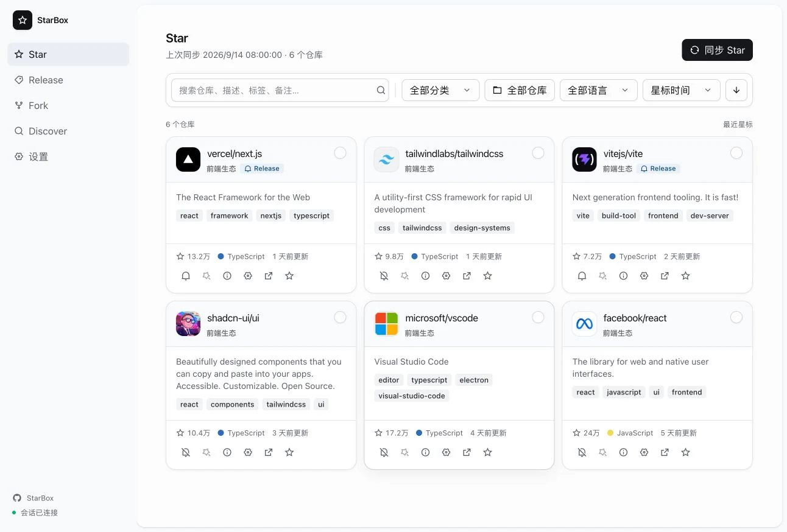

<div align="center">

# StarBox

**把 GitHub 收藏整理成自己的开发者工作台。**

搜索与整理 Stars，跟进 Release，维护 Fork；自托管于 Cloudflare Workers，数据存于自己的 D1。

[](https://github.com/iPotatow/StarBox/actions/workflows/ci.yml)
[](LICENSE)

简体中文 · [繁體中文](README.zh-TW.md) · [English](README.en.md)

</div>

GitHub 的 Star 方便收藏，长期使用却需要更多：重新找到那个工具、记住为什么收藏、知道它有没有新版本。StarBox 把这些后续工作放在一起，适合想持续维护自己 GitHub 收藏的开发者。

- **找回并整理收藏**：搜索仓库、描述、标签和备注，用分类保存自己的组织方式，直接阅读 README。
- **跟进项目变化**：订阅 Release、浏览历史版本、按平台推荐安装包，查看已有 Fork 的上游差异和 Actions 状态。
- **按需交给 AI**：生成摘要、辅助分类和批量整理；通过 MCP 让外部助手读取收藏，并按权限编辑。AI 可选，基础收藏管理不依赖它。

## 快速开始

准备 **Node.js 22**、npm，以及可使用 **Workers + D1** 的 Cloudflare 账号。

```bash
git clone https://github.com/iPotatow/StarBox.git
cd StarBox
npm ci
npx wrangler login
npm run deploy
```

部署脚本会检查或创建 D1 数据库，并处理受支持的初始化和升级路径，无需手填数据库 UUID。

首次部署后：

1. 为 `starbox` Worker 配置 **Custom Domain 或 Route**，仓库默认关闭 `workers.dev`。
2. 设置登录密码和凭据加密密钥：

   ```bash
   npx wrangler secret put LOGIN_PASSWORD
   npx wrangler secret put STARBOX_ENCRYPTION_KEY
   # 可选：默认用户名为 admin
   npx wrangler secret put LOGIN_USERNAME
   ```

3. 登录，点击星标首页的 **连接 GitHub**，完成验证后同步 Stars。也可从 **设置 → 账户与 GitHub** 管理连接。

多 Cloudflare 账号时，可在部署前设置 `CLOUDFLARE_ACCOUNT_ID`。升级已有实例前，请先备份 D1，并保留原来的 `STARBOX_ENCRYPTION_KEY`。

## 从收藏到工作台



连接 GitHub 后，StarBox 同步你的收藏；分类、备注和订阅保存到 D1，IndexedDB 提供本地缓存。未连接时，已有收藏仍可浏览和本地搜索。

连接弹窗提供 **前往 GitHub 创建 Token** 和 **如何配置权限**。支持 Fine-grained 与 Classic Token，建议设置有效期。Fine-grained Token 同步 Stars 使用 **Starring → Read-only**；需要取消 Star 时再启用 **Read and write**。私有仓库需加入授权范围，读取其 Actions 状态还需 **Actions → Read-only**。详见 [GitHub 权限文档](https://docs.github.com/en/rest/activity/starring#list-repositories-starred-by-the-authenticated-user)。

## 可选的 AI 与 MCP

| 能力 | 开始使用 |
| --- | --- |
| Cloudflare Workers AI | 在 **设置 → AI** 添加服务，无需额外保存 AI API Key |
| 自定义模型服务 | 支持 OpenAI Compatible、Anthropic Messages 和 Google Gemini 等 HTTP 服务 |
| 外部 AI 助手 | 连接 `/mcp`，使用独立 Bearer Token；默认只读，编辑权限单独开启 |

MCP 支持搜索收藏、读取仓库与 README、查询分类和 Release，以及授权后的备注、分类和标签编辑。Workers AI 官方每日用量面板需要另行配置只读统计凭据。配置细节见 [Workers AI](WORKERS_AI.md) 和 [MCP](MCP.md)。

## 数据与使用边界

- GitHub Token、HTTP AI Key 和敏感请求头由 Worker 加密后写入 D1，读取接口不返回明文。
- 仓库用户字段使用版本校验，避免覆盖较新的修改；MCP 编辑复用同一套并发保护。
- README 与 Release Markdown 支持 GFM，原始 HTML 不执行。
- 当前维护已有 Fork，不创建新的 Fork。
- MCP 客户端需支持自定义 Bearer 请求头；目前不提供仅 OAuth 的连接方式。

## 本地开发与验证

```bash
npm ci
npm run dev
```

`npm run dev` 在 `http://127.0.0.1:4173` 提供静态 UI 预览，`/api/*` 和 `/mcp` 返回 501。验证登录、GitHub 或其他业务接口，需要使用 Wrangler 和本地 D1。

```bash
npm run check
STARBOX_DEPLOYMENT_URL=https://your-domain.example npm run deploy:verify
```

完整检查包括类型、自动化测试和生产构建；`npm run coss:verify` 仅作手动 UI 审查。线上验证检查数据库、登录及加密配置；未设置 `STARBOX_DEPLOYMENT_URL` 时会跳过。本地通过不代表已经部署。

## 文档与技术

**React 19 · TypeScript · Tailwind CSS 4 · Cloudflare Workers · D1 · Base UI**

UI primitives 采用 [COSS](https://github.com/cosscom/coss) 的 copy/paste-and-own 模式，图标使用 [Phosphor Icons](https://phosphoricons.com/)。

[Workers AI](WORKERS_AI.md) · [MCP](MCP.md) · [验证范围](VERIFICATION.md) · [第三方声明](THIRD_PARTY_NOTICES.md)

## 许可证与维护者

[MIT](LICENSE) · 由 [iPotatow](https://github.com/iPotatow) 维护。
